# Smart Parking Lot Management System

**Submitted by:** Pranav Napolean  
**Roll No.:** 25CSB1A69  
**Programme:** B.Tech CSE (AI & DS)  
**Department:** Department of Computer Science and Engineering  
**Institute:** National Institute of Technology Warangal  
**Course:** CS2203 Python Programming

## Problem Statement

Managing a parking lot by hand is slow and prone to mistakes. Attendants have to search for free slots and write down entry times. They also have to work out each fee themselves. This leads to lost records and wrong charges. This project builds a Python program that does this work automatically and keeps a record of every visit.

## Objectives

1. Model the parking lot using Python classes and objects.
2. Give an arriving vehicle a free slot of the correct type.
3. Track which slots are free at any time.
4. Calculate the parking fee for each type of vehicle.
5. Print a receipt when a vehicle leaves and keep a payment history.
6. Store all data in an SQL database so that it is kept between runs.
7. Check all input and report errors clearly without stopping the program.

## Project Description

The lot has 5 car slots numbered 1 to 5 and 5 bike slots numbered 6 to 10.

When a vehicle arrives the program first checks the plate number. It then gives the vehicle the first free slot of its type and records the entry time. When the vehicle leaves the program calculates the fee and frees the slot. It prints a receipt and saves a copy as a text file. The full payment history can also be exported to a CSV file.

The program stores its data in an SQLite database with three tables. One table holds vehicles. A second holds parking slots. A third holds payments.

### Parking Fees

1. Cars pay Rs. 20 for every hour or part of an hour.
2. Bikes pay Rs. 10 for every hour or part of an hour.
3. A bike never pays more than Rs. 100 for one day.
4. Every stay is charged for at least one hour.

## How to Run

The program needs Python 3.8 or newer. No extra packages are required.

1. Unzip the project folder.
2. Open a terminal inside that folder.
3. Run the command below.

```
python main.py
```

The database file is created on the first run. Delete parking.db to start again with an empty lot.

The program shows this menu.

```
1. Park vehicle
2. Remove vehicle (pay and get receipt)
3. Show slot availability
4. Show parked vehicles
5. Show payment history
6. Export payments to CSV
7. Exit
```

To run the automated tests use this command.

```
python -m unittest discover tests
```

## Project Structure

```
main.py            Menu and user input
parking_lot.py     ParkingLot class
vehicle.py         Vehicle base class with Car and Bike
parking_slot.py    ParkingSlot class
payment.py         Payment class and receipts
database.py        SQLite connection and tables
exceptions.py      Custom error classes
tests              Automated tests
docs/screenshots   Screenshots of the program
```

## UML Class Diagram

Car and Bike inherit from the abstract Vehicle class. ParkingLot owns many ParkingSlot objects. It parks vehicles and creates a Payment when a vehicle leaves. A minus sign marks a private attribute. Abstract methods are shown in italics.

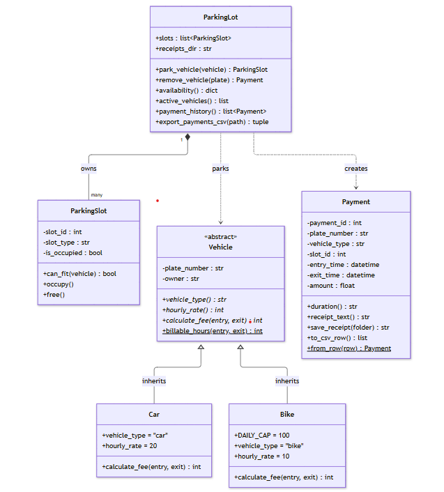

All custom errors inherit from ParkingError.

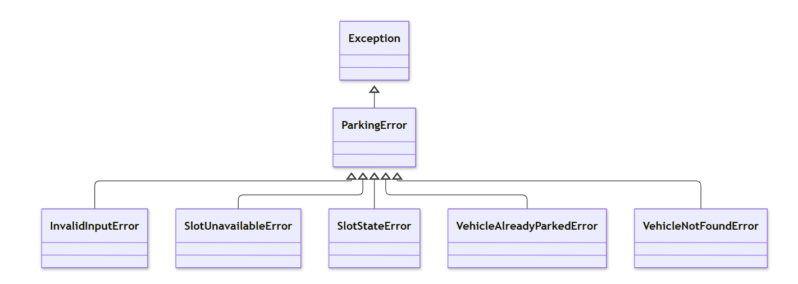

### Database Design

A payment row is created when a vehicle enters. Its exit time and amount stay empty until the vehicle leaves.

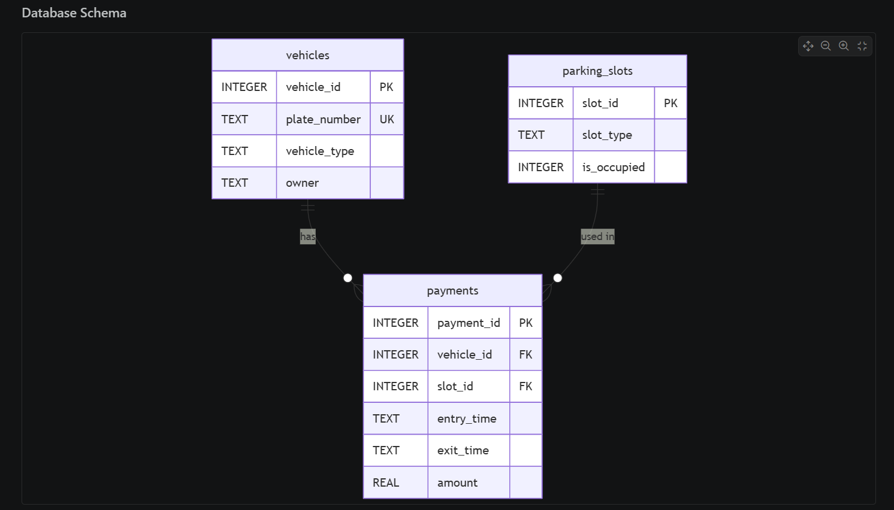

## Object Oriented Concepts Used

**Abstraction.** Vehicle is an abstract class. It states what every vehicle must provide but not how. Car and Bike fill in the details. A plain Vehicle object cannot be created.

**Inheritance.** Car and Bike inherit the plate checks and shared helper methods from Vehicle. All custom errors inherit from ParkingError.

**Method overriding.** Car and Bike each override the fee calculation method. Cars pay a flat hourly rate. Bikes pay a lower rate with a daily limit.

**Polymorphism.** When a vehicle leaves the ParkingLot calls its fee method without checking its type. Python runs the Car version or the Bike version as needed.

**Encapsulation.** Data inside Vehicle and ParkingSlot and Payment is private. Plate numbers and owner names are checked every time they are set. A slot changes state only through its occupy and free methods. These refuse invalid changes such as filling a slot that is already taken.

**Composition.** A ParkingLot holds its ParkingSlot objects. It also creates Payment objects.

## Exception Handling

Each expected problem has its own exception class. Examples include a full lot and an invalid plate number. Another is a vehicle that tries to park twice. The menu catches these errors and shows a short message. It also handles database errors and file errors. The program never stops with a traceback.

## File Handling

Data is kept between runs in three ways.

1. The SQLite database stores all vehicles and slots and payments.
2. Each receipt is saved as a text file in the receipts folder.
3. The payment history can be exported to payments.csv.

## Sample Input and Output

**1. Main menu**

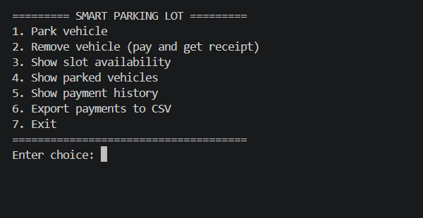

**2. Parking a car.** The car gets slot 1.

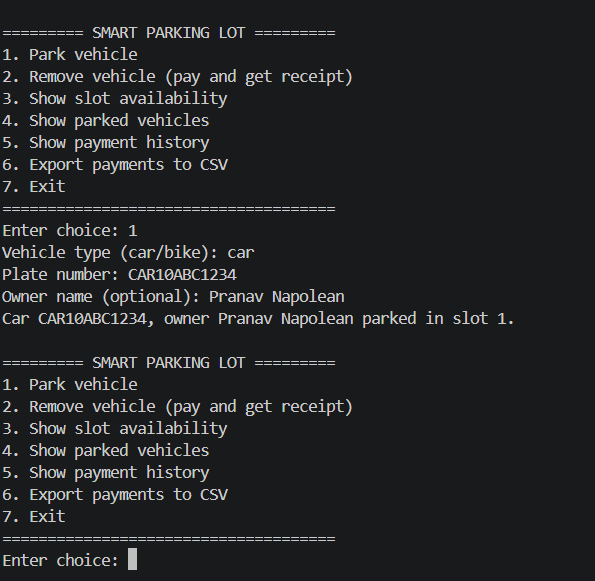

**3. Invalid input.** An unknown vehicle type shows an error and the program continues.

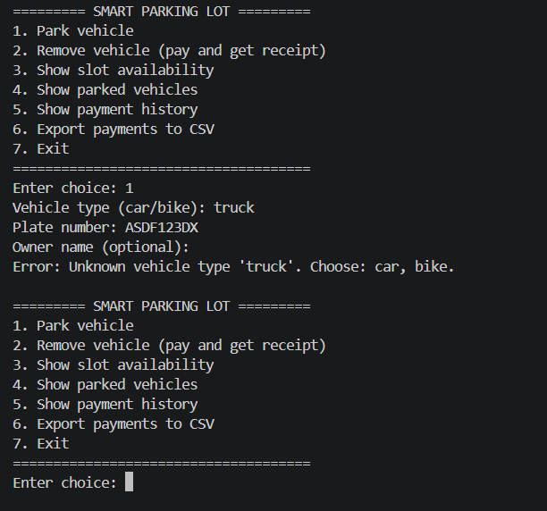

**4. Parking a bike and checking availability.** The bike gets slot 6 because bikes use their own slots.

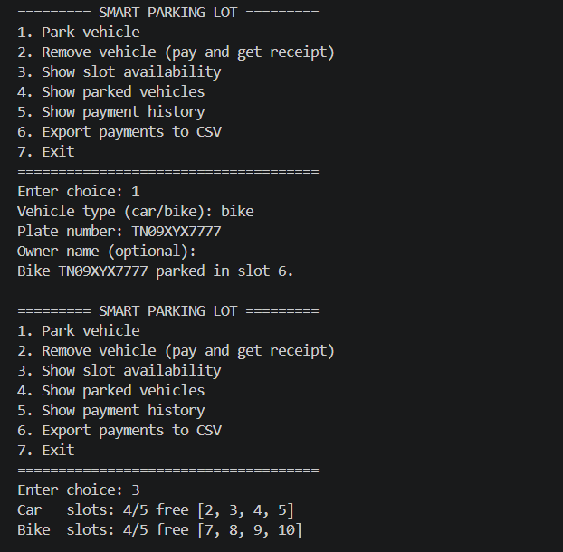

**5. Parked vehicles**

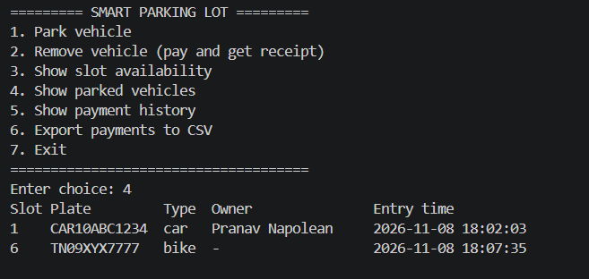

**6. Checkout and receipt.** A five minute stay is charged for one full hour.

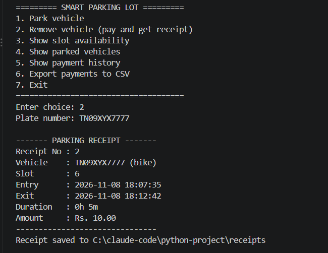

**7. Receipt saved as a text file**

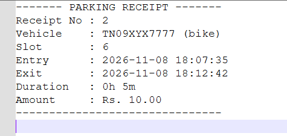

**8. Payment history exported to CSV and opened in Excel**

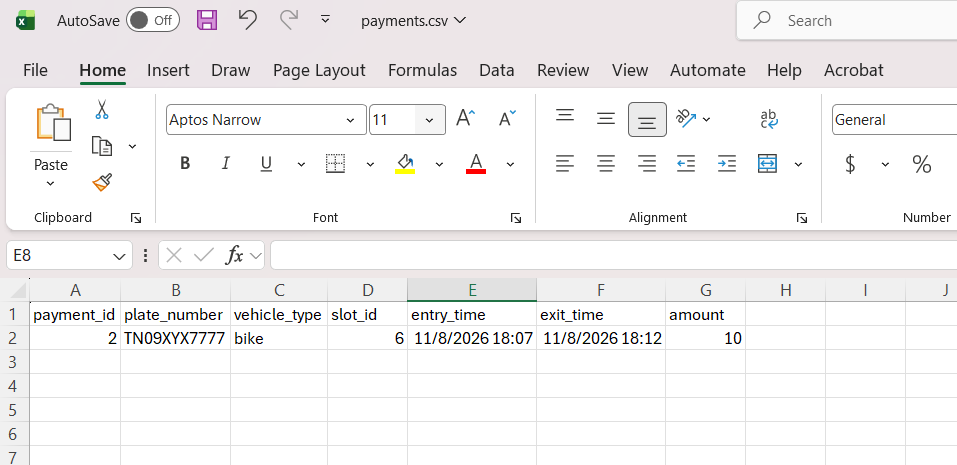

## Test Cases and Results

The project has 24 automated tests. Each test uses its own temporary database so real data is never changed. All 24 tests pass.

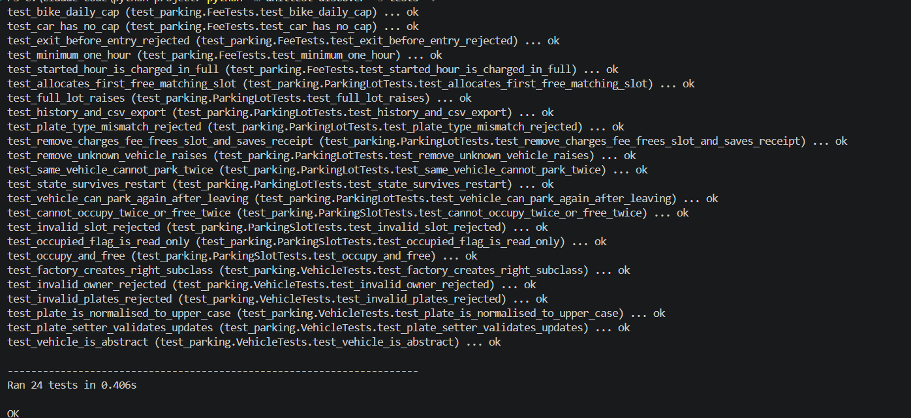

### Vehicle Tests

1. A plain Vehicle object cannot be created. **Pass**
2. A plate typed in lower case is stored in upper case. **Pass**
3. Invalid plates such as an empty plate or AB@12 are rejected. **Pass**
4. Changing a plate to an invalid value is refused and the old plate is kept. **Pass**
5. An owner name with digits or with more than 50 letters is rejected. **Pass**
6. The names car and bike create the right class and an unknown type is rejected. **Pass**

### Fee Tests

7. A short stay is charged for one full hour. **Pass**
8. A car parked for 2 hours 1 minute pays Rs. 60. **Pass**
9. A bike pays Rs. 100 for 12 hours and Rs. 120 for 26 hours. **Pass**
10. A car parked for 12 hours pays Rs. 240. **Pass**
11. An exit time earlier than the entry time is rejected. **Pass**

### Parking Slot Tests

12. A slot can be filled and then freed. **Pass**
13. Filling a full slot or freeing an empty slot is refused. **Pass**
14. The occupied status of a slot cannot be changed directly. **Pass**
15. A slot numbered 0 or with an unknown type is rejected. **Pass**

### Parking Lot Tests

16. Each vehicle gets the first free slot of its type. **Pass**
17. Parking is refused when all slots of that type are full. **Pass**
18. The same vehicle cannot park twice. **Pass**
19. A plate stored as a car cannot later park as a bike. **Pass**
20. A car removed after 2 hours 30 minutes pays Rs. 60. Its slot is freed and its receipt file is saved. **Pass**
21. Removing a vehicle that is not parked is refused. **Pass**
22. A vehicle can park again after it leaves. **Pass**
23. Parked vehicles are still listed after the program restarts. **Pass**
24. The payment history and the CSV file both list every payment correctly. **Pass**

### Manual Menu Tests

25. Menu choice 9 shows an error and the menu appears again. **Pass**
26. Vehicle type truck shows an error. **Pass**
27. Plate number !! shows an error. **Pass**
28. Removing plate NOPE123 shows an error. **Pass**
29. Pressing Ctrl+Z and then Enter closes the program cleanly. **Pass**
30. A parked bike is still listed after the program is restarted. **Pass**

## Conclusion

The project meets its objectives. It allocates slots and tracks availability. It calculates fees and produces receipts. It keeps all records between runs. The design uses abstraction and inheritance along with polymorphism and encapsulation. Composition links the parking lot to its slots. Possible future work includes reserved slots and monthly passes and a graphical interface.
