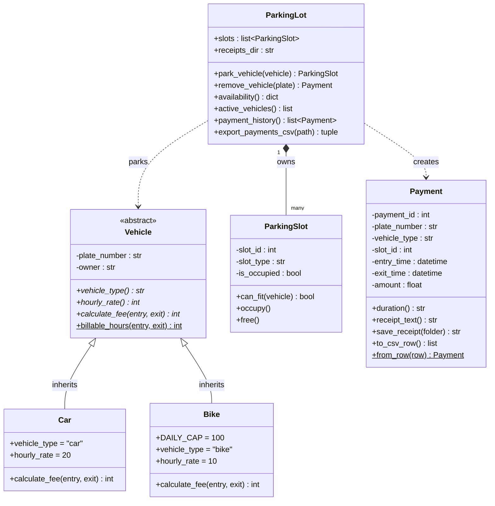
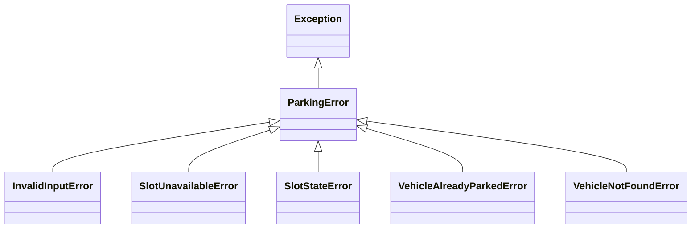
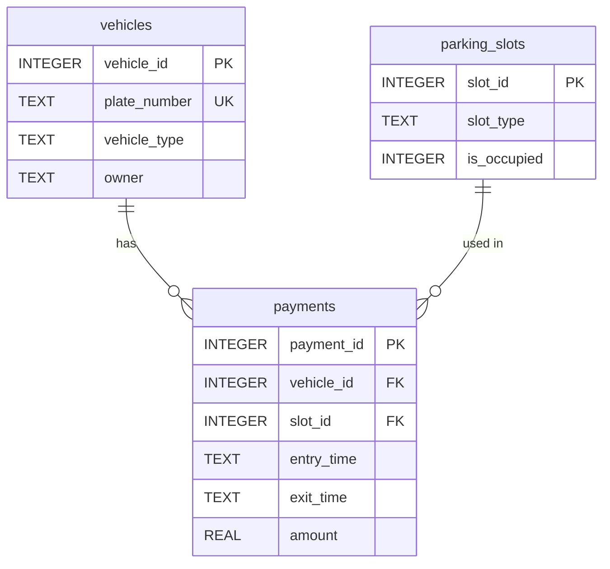

# Smart Parking Lot Management System

A menu-driven Python application that manages a parking lot. It allocates slots to cars and bikes, tracks which slots are free, calculates parking fees and generates receipts. Vehicles, parking slots and payments are stored in an SQLite database. Receipts are saved as text files, and payment history can be exported to CSV.

## Problem Statement

Manual parking management is slow and error-prone. Attendants have to find free slots by hand, note entry times on paper and work out fees themselves, which leads to lost records, wrong charges and disputes. A software system can allocate slots automatically, record every entry and exit, apply the correct tariff for each vehicle type and give the customer a receipt.

## Objectives

- Model a parking lot with object-oriented classes: `Vehicle`, `Car`, `Bike`, `ParkingSlot`, `ParkingLot` and `Payment`.
- Allocate the first free slot of the matching type (car or bike) when a vehicle arrives.
- Track slot availability in real time.
- Calculate parking fees using per-vehicle tariffs.
- Generate a receipt for every exit and keep a payment history.
- Store data in SQL (SQLite) so it is kept between runs, and use text and CSV files for receipts and reports.
- Validate all input and handle invalid operations with clear error messages.

## Project Description

The lot starts with **5 car slots (1–5)** and **5 bike slots (6–10)**. When a vehicle parks, the system:

1. checks that the plate number is valid and the vehicle is not already parked,
2. assigns the first free slot of the right type,
3. records the vehicle and its entry time in the database.

When the vehicle leaves, the system calculates the fee, marks the slot free, stores the payment and prints a receipt. The receipt is also saved to `receipts/receipt_<no>.txt`.

### Tariffs

| Vehicle | Rate | Rule |
|---|---|---|
| Car | Rs. 20 per hour | Every started hour is charged in full, with a minimum of 1 hour |
| Bike | Rs. 10 per hour | Same as car, but capped at Rs. 100 per day (24 hours) |

## How to Run

**Requirements:** Python 3.8 or newer. No extra packages are needed, since only the standard library is used (`sqlite3`, `csv`, `abc`, `datetime`).

```bash
git clone https://github.com/falcon370/smart-parking-lot.git
cd smart-parking-lot
python main.py
```

The database `parking.db` is created automatically on the first run. To start again with an empty lot, delete `parking.db`.

### Menu

```
========= SMART PARKING LOT =========
1. Park vehicle
2. Remove vehicle (pay and get receipt)
3. Show slot availability
4. Show parked vehicles
5. Show payment history
6. Export payments to CSV
7. Exit
=====================================
```

### Running the Tests

```bash
python -m unittest discover -s tests -v
```

The tests use a temporary database, so your real data is never changed. See [TEST_CASES.md](TEST_CASES.md) for the full list of test cases and their results.

## Project Structure

```
main.py           Menu-driven user interface
parking_lot.py    ParkingLot: allocation, fees, history, CSV export
vehicle.py        Vehicle (abstract), Car, Bike, create_vehicle() factory
parking_slot.py   ParkingSlot
payment.py        Payment: receipt text, receipt file, CSV row
database.py       SQLite connection and table creation
exceptions.py     Custom exception classes
tests/            Unit tests
docs/             Sample run output and screenshots
```

Files created while the program runs (not stored in git): `parking.db`, `receipts/`, `payments.csv`.

## UML Class Diagram

Each diagram fits on one screen, so it can be screenshotted directly from this page on GitHub.

**Legend:** `+` public · `-` private (read through a property) · *italic* = abstract · underlined = static or class method · `<|--` inheritance · `*--` composition (the lot owns its slots) · `..>` uses or creates

### Classes



### Exception Hierarchy



### Database Schema



A row is added to `payments` when a vehicle enters, with `exit_time` and `amount` empty. A vehicle counts as currently parked while its `exit_time` is empty, and the row is completed when it leaves.

## How the Requirements Are Met

| Requirement | Where it is implemented |
|---|---|
| Classes and objects (6 classes and an exception hierarchy) | `Vehicle`, `Car`, `Bike`, `ParkingSlot`, `ParkingLot`, `Payment` |
| **Abstraction** | `Vehicle` is an abstract base class (`ABC`). It cannot be created directly and declares the abstract members `vehicle_type`, `hourly_rate` and `calculate_fee`. |
| **Inheritance** | `Car` and `Bike` inherit from `Vehicle`, and all custom exceptions inherit from `ParkingError`. |
| **Method overriding** | `Car.calculate_fee` and `Bike.calculate_fee` each override the abstract method. Bike adds a daily cap. |
| **Polymorphism** | `ParkingLot.remove_vehicle` calls `vehicle.calculate_fee(...)` without knowing whether it is a car or a bike. `create_vehicle()` builds the right subclass from a type name. |
| **Encapsulation** | Private `__attributes` in `Vehicle`, `ParkingSlot` and `Payment`. Validating setters check plate numbers and owner names. `is_occupied` is read-only and only changes through `occupy()`/`free()`, which refuse invalid changes. |
| **Composition** | A `ParkingLot` owns its `ParkingSlot` objects and creates `Payment` objects. |
| **Exception handling** | Custom exceptions in `exceptions.py` (invalid plate or type, lot full, already parked, not found). The menu catches `ParkingError`, `sqlite3.Error`, `OSError` and `Ctrl+C`/`Ctrl+D`. |
| **Data between runs** | SQLite database (`parking.db`), text receipts (`receipts/*.txt`) and CSV export (`payments.csv`). |
| **Menu-driven interface** | `main.py` |

## Sample Input and Output

See [docs/sample_run.md](docs/sample_run.md) for a complete session, and [docs/screenshots/](docs/screenshots/) for screenshots.

```
Enter choice: 1
Vehicle type (car/bike): car
Plate number: ka01ab1234
Owner name (optional): Ravi Kumar
Car KA01AB1234, owner Ravi Kumar parked in slot 1.

Enter choice: 2
Plate number: KA01AB1234

------- PARKING RECEIPT -------
Receipt No : 1
Vehicle    : KA01AB1234 (car)
Slot       : 1
Entry      : 2026-11-08 10:00:00
Exit       : 2026-11-08 12:15:00
Duration   : 2h 15m
Amount     : Rs. 60.00
-------------------------------
```
