# Screenshots

Screenshots of the program running from a fresh database, in the order a user would go through it. For the full text of a session, see [../sample_run.md](../sample_run.md).

| # | Screenshot | Shows |
|---|---|---|
| 1 | [Main menu](#1-main-menu) | Menu-driven interface |
| 2 | [Parking a car](#2-parking-a-car) | Slot allocation, input normalisation |
| 3 | [Invalid input](#3-invalid-input) | Exception handling |
| 4 | [Parking a bike and availability](#4-parking-a-bike-and-slot-availability) | Separate slot types, availability tracking |
| 5 | [Parked vehicles](#5-parked-vehicles-report) | Data read back from SQLite |
| 6 | [Checkout and receipt](#6-checkout-and-receipt) | Fee calculation (polymorphism), receipt |
| 7 | [Receipt file](#7-saved-receipt-file) | File handling: text file |
| 8 | [CSV export](#8-payment-export-csv) | File handling: CSV |
| 9 | [Test results](#9-unit-test-results) | 24 automated tests passing |
| 10 | [Database schema](#10-database-schema) | SQL tables for vehicles, slots and payments |
| 11 | [UML class diagram](#11-uml-class-diagram) | Abstraction, inheritance, composition |
| 12 | [Exception hierarchy](#12-exception-hierarchy) | Custom exceptions |

## 1. Main menu

The menu shown when the program starts (`python main.py`). It appears again after every action.

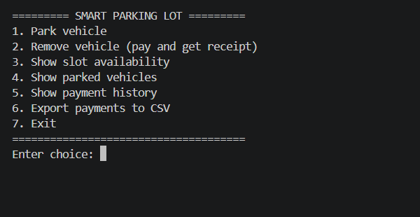

## 2. Parking a car

Option 1 with a car. The system gives it the first free car slot (slot 1) and stores the vehicle and its entry time in the database.

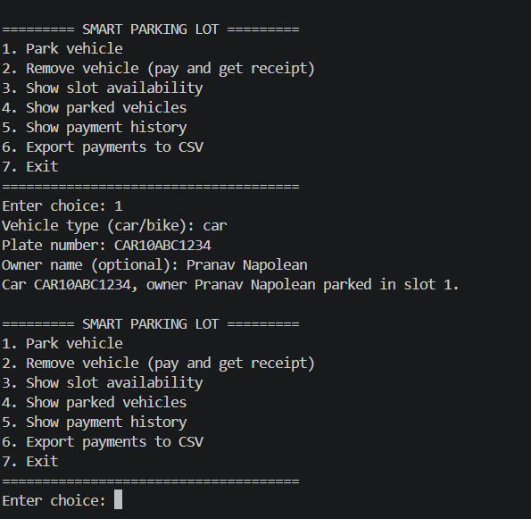

## 3. Invalid input

Entering an unknown vehicle type (`truck`) raises an `InvalidInputError`. The menu catches it, shows a clear message and carries on instead of crashing.

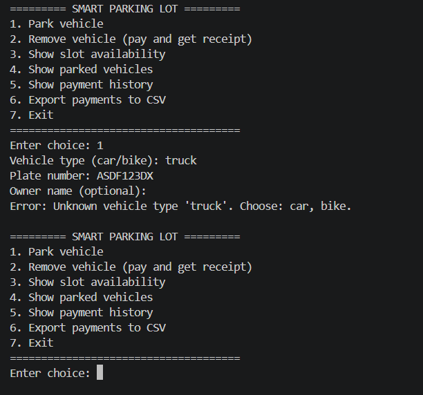

## 4. Parking a bike and slot availability

A bike goes to slot 6, the first bike slot, because cars and bikes use separate slots. Option 3 then shows 4 of 5 slots free for each type.

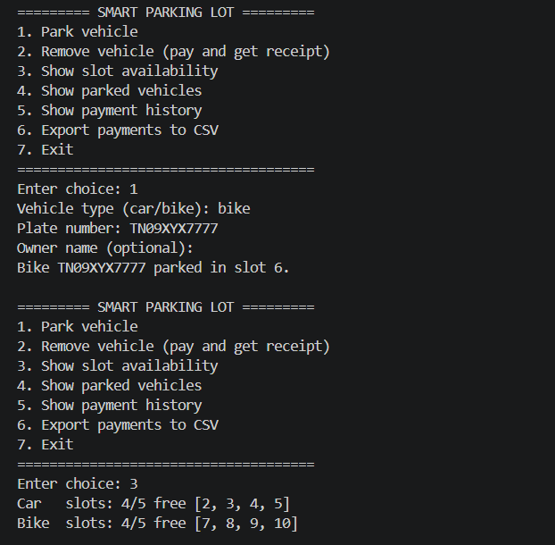

## 5. Parked vehicles report

Option 4 lists every vehicle currently in the lot, with its slot, owner and entry time, read from the SQLite database.

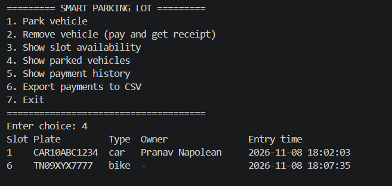

## 6. Checkout and receipt

Option 2 removes the bike. `Bike.calculate_fee()` charges a minimum of 1 hour at Rs. 10 for the 5-minute stay. The slot is freed and a receipt is printed.

The receipt number is 2 because a payment record is created when a vehicle *enters*. Record 1 belongs to the car, which is still parked.

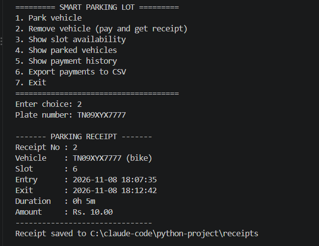

## 7. Saved receipt file

The same receipt saved as a text file, `receipts/receipt_2.txt`, so it is kept after the program closes.

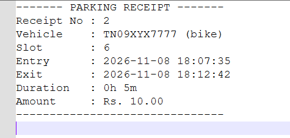

## 8. Payment export (CSV)

Option 6 writes the payment history to `payments.csv`, shown here opened in Excel. Excel reformats the dates and shows `10.00` as `10`. The file itself stores `2026-11-08 18:07:35` and `10.00`.

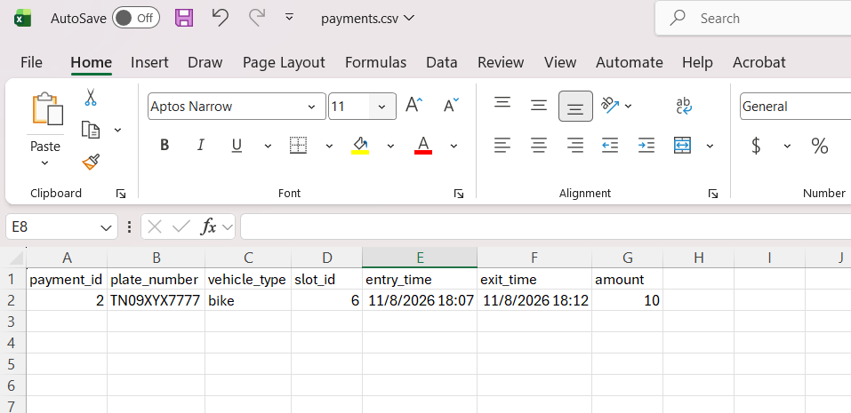

## 9. Unit test results

`python -m unittest discover -s tests -v`: all 24 tests pass. See [../../TEST_CASES.md](../../TEST_CASES.md) for what each test checks.

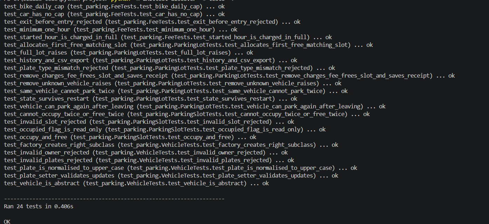

## 10. Database schema

The three SQL tables and how they are linked. A `payments` row is a parking session: `exit_time` and `amount` stay empty until the vehicle leaves.

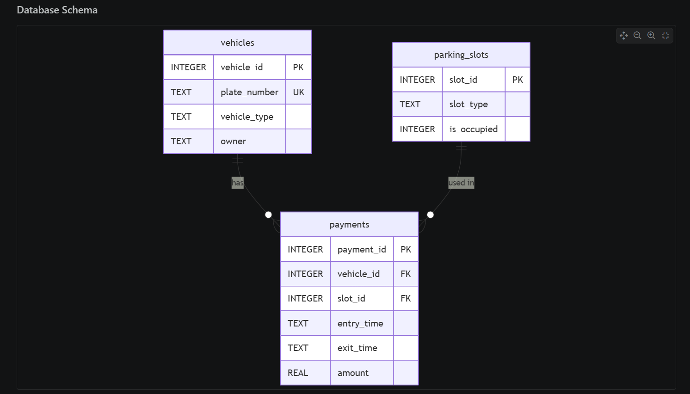

## 11. UML class diagram

The main classes. `Car` and `Bike` inherit from the abstract `Vehicle` and each override `calculate_fee()`. `ParkingLot` owns its `ParkingSlot` objects (composition), parks vehicles and creates a `Payment` when a vehicle leaves. `-` marks private attributes, *italic* marks abstract methods, and underlined methods are static or class methods.

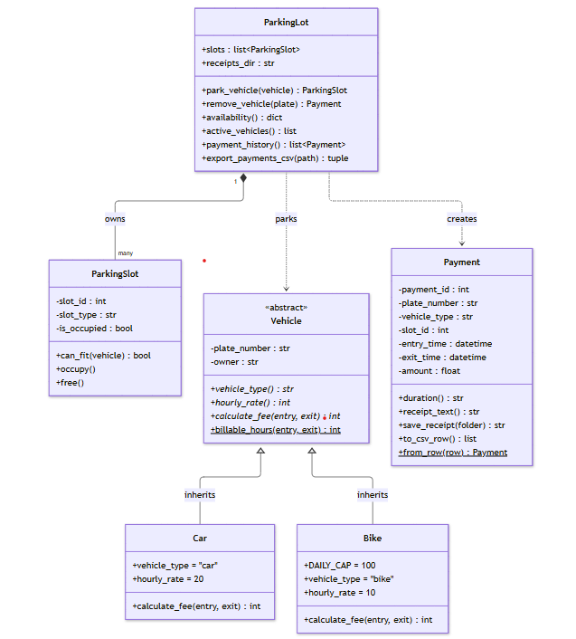

## 12. Exception hierarchy

All custom errors inherit from `ParkingError`, so the menu can catch every expected problem with one `except ParkingError`.

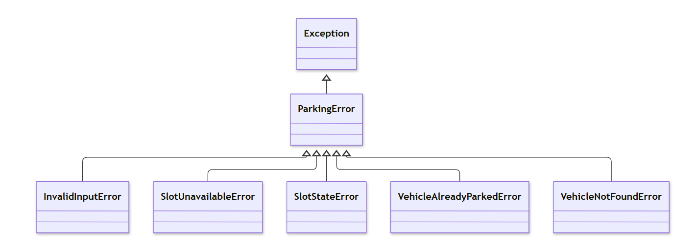
